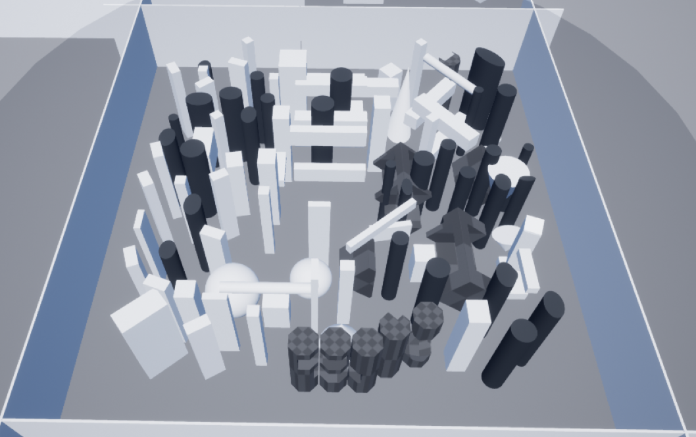
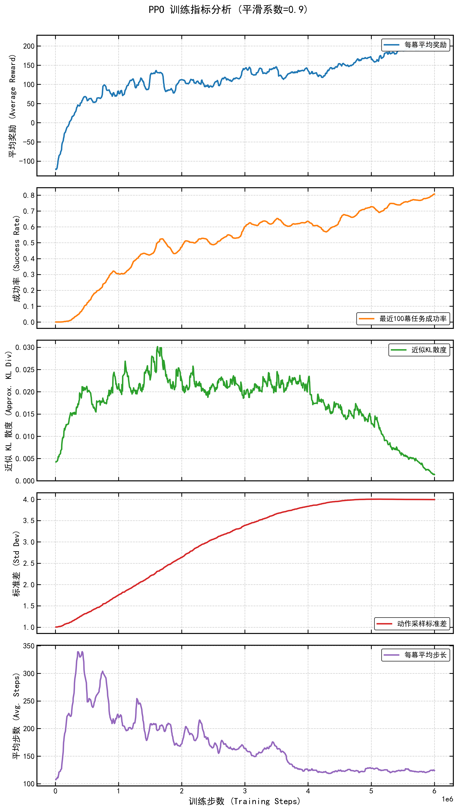
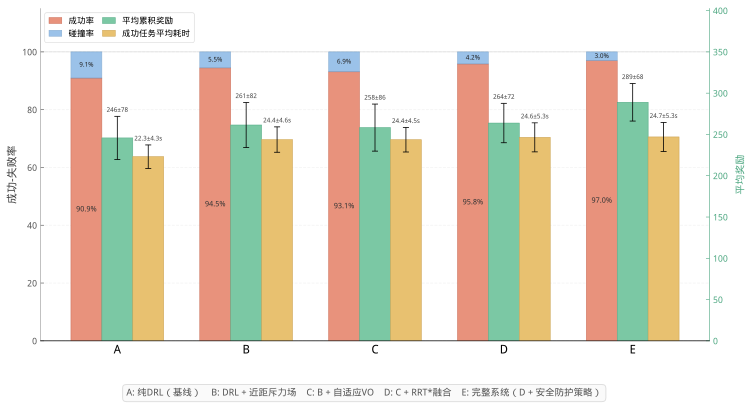
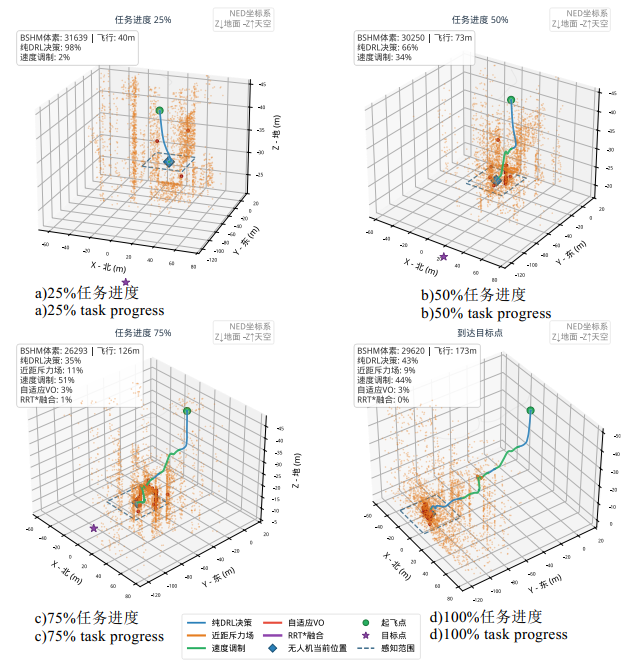

# UAV Autonomous Obstacle Avoidance in Unknown Environments via Deep Reinforcement Learning

**English** | [简体中文](README.zh-CN.md)

**A complete, end-to-end research stack for LiDAR-based 3D autonomous obstacle avoidance on a quadrotor — from a distributed parallel AirSim simulator, to a block-sparse probabilistic map, to a curriculum-trained policy, to a hybrid safety shield.**

[](LICENSE)
[]()
[](ROADMAP.md)

> **Status.** Branch **`origin_26-0364`** is the frozen snapshot of the project as it
> stood when the journal article was accepted — it is the archival reference for this
> paper. `main` continues forward and is being migrated to **NVIDIA Isaac Lab + PX4
> SITL**; see [`ROADMAP.md`](ROADMAP.md).
>
> **What is in the repository.** Code, documentation, the ablation tables, all 51
> training runs (raw TensorBoard event files, 50 MB) and decimated CSV curves. Policy
> checkpoints are **not** in git — they exceed GitHub's per-file limit and are
> published as Release assets, catalogued in [`MODELS.md`](MODELS.md).

---

## News / Roadmap snapshot

| | |
|---|---|
| ✅ | Stage 1 — AirSim + SB3: distributed parallel sim, BSHM map, curriculum PPO policy, 5-layer safety shield, full evaluation & ablation suite |
| 🚧 | Stage 2 — Isaac Lab migration (GPU-parallel RL, 512–1024 envs) |
| 🚧 | Stage 3 — PX4 SITL software-in-the-loop (MAVLink HIL), policy → OFFBOARD velocity setpoints |
| 📄 | Journal paper published in *Journal of System Simulation* (基于渐进课程学习的无人机自主避障研究) |

---

## What this project does

A quadrotor must fly ~100–150 m through an **a priori unknown, cluttered 3D environment** and reach a goal it has never mapped, using **only a mechanical spinning LiDAR plus its own kinematic state**. No global map, no prior knowledge of the environment, no privileged target coordinates in the observation.

The system has four layers:

| # | Layer | Responsibility |
|---|---|---|
| 1 | **Simulator** | AirSim (UE4) distributed parallel platform; self-built UDP data-exchange hub at 20 Hz for sensors and commands; multi-drone isolation patch (inter-drone collision and LiDAR occlusion disabled) |
| 2 | **Perception** | LiDAR point cloud → Block Sparse Hash Map (BSHM): 64 m blocks, 0.25 m voxels, Bayesian occupancy, dual-layer temporal decay (probability decay + LRU eviction) → 18 × 36 heading-frame range image |
| 3 | **Policy** | Dual-Branch Extractor — a CNN for the map, an MLP for the task vector — into a PPO Actor/Critic with separate trunks (ELU). Output: velocity increment Δv ∈ ±3.75 m/s. Trained with the progressive reward-shaping curriculum |
| 4 | **Safety shield** | Proximity APF → adaptive-horizon VO-τ → RRT\*-Safe → distribution-shift guard → distance-based speed modulation. Deterministic rules verify and clamp whatever the policy proposes |

End-to-end data flow:

```
LiDAR -> BSHM -> 18x36 range image  +  8-D task vector
      -> DBE -> PPO -> delta-v -> safety shield -> velocity PID -> AirSim
```

### The training scene



A walled **250 × 250 × 50 m** field containing roughly **70 obstacle actors**, built entirely from
Unreal primitives and instanced from three cube meshes plus the engine's cylinder / cone / sphere
shapes: slabs and pillars (the dominant, "building-like" majority), cylinders, cones and pyramids,
spheres, and irregular compound bodies (the studded cylinders in the foreground). The obstacle cloud
occupies the central region, leaving an open band along the perimeter walls; start and goal are
sampled at random within the reachability band described in the paper.

The scene itself is committed at
[`sim/airsim/project/Content/FlyingCPP/Maps/FlyingExampleMap.umap`](sim/airsim/project/Content/FlyingCPP/Maps/FlyingExampleMap.umap);
the surrounding UE4 project, the packaged standalone build and how to obtain them are in
[`sim/airsim/ENVIRONMENT.md`](sim/airsim/ENVIRONMENT.md).

---

## Results

### Ablation of the hybrid safety shield
Monte-Carlo evaluation in the training scene; identical policy checkpoint, shield layers toggled cumulatively.

| Configuration | Episodes | Success | Collision | Return | Time (success) |
|---|---:|---:|---:|---:|---:|
| Pure DRL policy | 309 | **90.94 %** | 9.06 % | 245.80 ± 78.36 | 22.31 ± 4.26 s |
| + proximity repulsion | 307 | 94.46 % | 5.54 % | 261.44 ± 81.76 | 24.38 ± 4.62 s |
| + adaptive VO-τ | 305 | 93.11 % | 6.89 % | 258.29 ± 85.50 | 24.36 ± 4.47 s |
| + RRT\*-Safe | 311 | 95.82 % | 4.18 % | 263.84 ± 71.64 | 24.65 ± 5.27 s |
| **Full system** | 525 | **96.95 %** | 3.05 % | **288.96 ± 68.27** | 24.70 ± 5.28 s |

Raw numbers: [`benchmarks/ablation_summary.json`](benchmarks/ablation_summary.json)

### Policy training & generalisation
| Metric | Value |
|---|---|
| Training budget | 6 M environment steps, 10 parallel drones, ~48 h |
| In-training success rate (last 100 eps) | 0.81 |
| Curriculum vs. no-curriculum control (same 6 M budget) | 0.810 vs. 0.764 |
| Generalisation — unseen 150 × 50 × 50 m corridor, 200 episodes | **68.2 %** |
| Off-policy control (SAC, identical reward/curriculum/network) | peaks 0.699, decays to 0.373 |

### Training convergence



Five metrics for the curriculum group over the full 6 M steps (curves smoothed, factor 0.9):

| Panel | What it shows |
|---|---|
| **Average reward / episode** | −120 at the cold start, +50 within the first ~0.5 M steps, then a steady climb to ≈ 200 |
| **Success rate** (last 100 eps) | 0 → **0.81**; the steepest part is between 1 M and 2 M steps |
| **Approx. KL divergence** | rises to ≈ 0.03 while the policy is still learning, oscillates around 0.02, then falls to ≈ 0 by 6 M — the update magnitude shrinks as the policy converges |
| **Action std** | 1.0 → 4.0, saturating after ~4 M steps: exploration is *not* annealed away, the stochastic policy settles at a stable spread |
| **Avg. steps / episode** | peaks near 340 in early, thrashing episodes, then settles to ≈ 110 — direct evidence that the final policy flies efficiently rather than wandering |

Crisp per-metric vector versions are in [`benchmarks/figures/`](benchmarks/figures/); the underlying
CSV of every metric is in
[`benchmarks/tb_curves/2026-03-18_paper-curriculum-6M.csv`](benchmarks/tb_curves/2026-03-18_paper-curriculum-6M.csv).

### MDP at a glance
| | |
|---|---|
| Observation | 656-D = 648-D (18 elevation × 36 azimuth range image, rotated into the **velocity-heading frame**) + 8-D task vector (goal direction, progress, velocity direction, speed) |
| Action | 3-D continuous velocity increment, Δv ∈ [−3.75, 3.75]³ m/s, |v| clamped to 7.5 m/s |
| Reward | 5 dense terms (obstacle, smoothness, forward, progress, survival) + sparse ±50/−80 ; three weights scheduled by training progress |
| Control | velocity-tracking PID cascade (offboard velocity set-points) |

Details, formulas and code references: [`docs/ARCHITECTURE.md`](docs/ARCHITECTURE.md)

### Results in figures



**Ablation of the hybrid safety shield, groups A–E.**
A = pure policy · B = +proximity repulsion · C = +adaptive VO-τ · D = +RRT\*-Safe · E = full system.
Left panel: success / failure rate. Middle: mean cumulative return. Right: duration of successful
episodes.



**One episode at 25 / 50 / 75 / 100 % task progress, with layer attribution.** The trajectory is
coloured by which decision layer produced each step, and every panel reports the map size, the
distance flown and the share of steps per layer. The shield engages *progressively* as the drone
enters the cluttered core: at 25 % task progress the policy alone flies **98 %** of the steps
(2 % speed modulation, 40 m flown, BSHM 31 639 voxels), while by the 75 % stage speed modulation
carries **51 %**, proximity repulsion 11 % and VO-τ 3 %; at the goal, 44 % / 9 % (173 m flown,
BSHM 29 620 voxels). That is the hybrid architecture behaving as designed — the learned policy in
open space, the deterministic layers in the dense interior.

<details>
<summary>Individual ablation panels and full-resolution links</summary>

| Figure | Link |
|---|---|
| Success / failure rate | [`ablation_a_success.svg`](RL_scripts/body-axis_v2/scripts/figures/ablation_a_success.svg) |
| Mean cumulative return | [`ablation_b_reward.svg`](RL_scripts/body-axis_v2/scripts/figures/ablation_b_reward.svg) |
| Successful-episode duration | [`ablation_c_time.svg`](RL_scripts/body-axis_v2/scripts/figures/ablation_c_time.svg) |
| Combined + named groups | [`ablation_results.svg`](RL_scripts/body-axis_v2/scripts/figures/ablation_results.svg) · [`.pdf`](RL_scripts/body-axis_v2/scripts/figures/ablation_results.pdf) |
| Task-progress stages, plain — 4829 × 5126 px | [`trajectory_stages_ep1.png`](RL_scripts/body-axis_v2/scripts/figures/trajectory_stages_ep1.png) · [`.pdf`](RL_scripts/body-axis_v2/scripts/figures/trajectory_stages_ep1.pdf) · [`.svg`](RL_scripts/body-axis_v2/scripts/figures/trajectory_stages_ep1.svg) |
| Shield trajectory, top view | [`shield_trajectory_ep1_topview.svg`](RL_scripts/body-axis_v2/scripts/figures/shield_trajectory_ep1_topview.svg) |
| Shield trajectory, 3-D view | [`shield_trajectory_ep1.svg`](RL_scripts/body-axis_v2/scripts/figures/shield_trajectory_ep1.svg) (2.1 MB) |

</details>

> Axis labels in these figures are in Chinese — they are the panels produced for the journal
> submission. Vector (`.svg`) and print-ready (`.pdf`) versions live next to them in
> `RL_scripts/body-axis_v2/scripts/figures/`.

---

## Repository layout

```
.
├── environment.yml                   # ★ exact runtime environment (conda, WSL2 / Ubuntu 24.04)
├── sim/
│   └── airsim/
│       ├── settings.json             # ★ AirSim config used for the results (10 drones + LiDAR)
│       ├── README.md                 # what each setting implies; why the drones are isolated
│       ├── ENVIRONMENT.md            # ★ the UE4 project: Blocks2_AirSim170, AirSim 1.7.0, the map
│       ├── figures/
│       │   └── training_scene.png    # what the scene looks like
│       └── project/                  # the training scene itself (13.6 MB): .umap, meshes, config
├── methods/                          # Reusable perception / solver utilities
│   ├── AirSim_ReinforceLearning/
│   │   ├── BSHM.py                   # ★ Block Sparse Hash Map (the paper's map)
│   │   ├── LidarProcess.py           # LiDAR parsing, body→global, down-sampling
│   │   ├── OctoMap_o3d.py            # Previous octree implementation (kept for reference)
│   │   └── ...
│   ├── Sensors1.json                 # stale sensor template — superseded by sim/airsim/
│   └── airsim_lidar.py
│
├── RL_scripts/
│   ├── body-axis_v2/                 # ★ Stage-1 final: policy + safety shield
│   │   ├── scripts/
│   │   │   ├── PPO_SB3_AirSim.py                 # policy training entry (no-curriculum control)
│   │   │   ├── PPO_SB3_AirSim_CL.py              # curriculum group (differs by 2 lines)
│   │   │   ├── PPO_SB3_AirSim_model.py           # full system incl. safety shield + eval
│   │   │   ├── vehicle_manager.py                # observation construction, BSHM wrapper
│   │   │   ├── airsim_datamanager*.py            # UDP data-exchange hub
│   │   │   ├── ablation_experiment.py            # 5-group shield ablation
│   │   │   ├── collision_diagnostics.py          # failure attribution
│   │   │   ├── train_sac.py / train_ddpg.py      # off-policy controls
│   │   │   ├── trajectory_visualizer.py, ...     # paper figures
│   │   │   └── figures/                          # generated figures
│   │   ├── results/  models/  logs/              # weights (ignored) / logs (committed)
│   │   └── ...
│   ├── body-axis_v2_plot/            # plotting / Monte-Carlo trajectory export
│   ├── body-axis/                    # earlier prototype (body-frame action)
│   ├── world-axis-v2/                # earlier prototype (world-frame map + W_dir v0)
│   └── airsim-only-with-lidar/       # earliest prototype
│
├── benchmarks/                       # Machine-readable result tables
│   ├── ablation_summary.json
│   ├── failure_analysis_sample.txt
│   ├── figures/                      # training-convergence panels (PNG + 5 crisp SVGs)
│   └── tb_curves/*.csv               # decimated training curves (6 runs)
├── docs/                             # ARCHITECTURE.md, REPRODUCING.md
├── paper/                            # Publication metadata, DOI, section→code map
├── scripts/
│   ├── export_tb_curves.py           # dependency-free TensorBoard scalar → CSV
│   └── repo_hygiene.py               # guard against committing large artefacts
├── MODELS.md                         # what each checkpoint is, how to obtain it
├── CITATION.cff
├── CHANGELOG.md
├── CONTRIBUTING.md
├── README.md / README.zh-CN.md
├── ROADMAP.md
└── requirements-legacy.txt
```

> ⚠️ **Note on naming.** Only `body-axis_v2/scripts` was renamed to
> `PPO_SB3_AirSim*.py`. The legacy prototypes in `body-axis/`, `world-axis-v2/`,
> `airsim-only-with-lidar/` and the `body-axis_v2_plot` copy still carry the
> historical `RecurrentPPO_*` filename so that published results stay traceable to
> the script that produced them. In every case the policy is a plain feed-forward
> `PPO("MlpPolicy")` with the custom `OctomapCNN` feature extractor — **there is no
> LSTM/GRU in this project**.

---

## Quick start (Stage 1 — AirSim)

**Environment.** The published results were produced in **WSL2 · Ubuntu 24.04** on an
**RTX 4070 SUPER** (CUDA driver 12.0) — simulator, data-exchange hub and trainer all inside
the *same* WSL2 instance. [`environment.yml`](environment.yml) is the exact conda export from
that machine, so it is the authoritative environment; `requirements-legacy.txt` is a pip-only
fallback.

```bash
conda env create -f environment.yml
conda activate airsim-gym-ubuntu2404
```

| Platform | GPU | CUDA | Python | Key pins |
|---|---|---|---|---|
| WSL2 · Ubuntu 24.04 | RTX 4070 SUPER | driver 12.0 (torch `cu124` wheels) | 3.11.14 | `airsim 1.7.0` · `stable-baselines3 2.7.0` · `torch 2.6.0` · `numpy 2.0.1` |

GPU passthrough into WSL2 needs a WSL-capable driver on the Windows side; after installing it,
`nvidia-smi` should list the GPU inside WSL2.

```bash
# 1. Start the AirSim scene. Either (a) use the project committed under sim/airsim/project/
#    (the .umap + config; needs UE 4.27), or (b) run the packaged standalone build
#    described in sim/airsim/ENVIRONMENT.md — no Unreal install needed.
#    Install AirSim's settings.json from sim/airsim/settings.json first (10 drones + LiDAR).
#    The multi-drone isolation patch is mandatory — see docs/REPRODUCING.md §2.

# 2. Launch the data-exchange hub — one process serves all drones:
python RL_scripts/body-axis_v2/scripts/airsim_datamanager.py

# 3. Train (fix the IP addresses first — see §IP configuration below).
#    The two paper groups differ by two lines — see docs/REPRODUCING.md §4:
python RL_scripts/body-axis_v2/scripts/PPO_SB3_AirSim_CL.py    # curriculum group
python RL_scripts/body-axis_v2/scripts/PPO_SB3_AirSim.py       # control group

# 4. Evaluate the full system (policy + safety shield):
python RL_scripts/body-axis_v2/scripts/PPO_SB3_AirSim_model.py

# 5. Reproduce the ablation table:
python RL_scripts/body-axis_v2/scripts/ablation_experiment.py

# 6. Redraw the training curves without re-training:
python scripts/export_tb_curves.py RL_scripts/body-axis_v2/logs --out benchmarks/tb_curves
```

Training logs go to `logs/` (TensorBoard, **committed for the archival runs**);
checkpoints go to `models/<timestamp>/` (**git-ignored**).

**Batch-size note.** `n_steps=2560` is *per environment* in Stable-Baselines3, so one
update consumes `n_envs × n_steps = 10 × 2560 = 25 600` transitions. The schedule
horizon `total_timesteps = 1 024 000 × 5 = 5.12 M` is exactly 200 such rollouts, which
is what makes the curriculum and entropy schedules land on the intended step count;
training then continues to 6 M steps with every schedule pinned at its terminal value.

### ⚠️ IP configuration — the most common place to get stuck

**Every address below is hard-coded in the repository and must be changed to your own**, otherwise
the trainer blocks forever waiting for observations. There are **three** distinct addresses, and they
are easy to confuse because two of them live in different files:

| Field | Where it appears | Value shipped in this repo | What it must point at |
|---|---|---|---|
| `airsim_ip` | `airsim_datamanager.py:380` | `172.21.224.1` | host running the **AirSim** executable (RPC port `41451`) |
| `trainmanager_ip` | `airsim_datamanager.py:380` | `172.21.236.121` | host that runs the **trainer** and receives the state stream |
| `datamanager_ip` / `trainmanager_ip` | `make_env()` in `PPO_SB3_AirSim*.py`, `train_sac.py`, `train_ddpg.py`, `PPO_SB3_AirSim_model.py` | `172.21.236.121` | host running `airsim_datamanager.py` (both fields; they are the same machine here) |

The original experiments therefore used **two machines**: AirSim at `172.21.224.1`, and the hub plus
trainer together at `172.21.236.121`. A single-machine setup is fine — then all three fields take
that one address.

```python
# PPO_SB3_AirSim.py — replace the two addresses with your own
def make_env(uavname):
    def _init():
        env = AirSimDroneEnv(uavname=uavname,
                             datamanager_ip='172.21.236.121',   # <- your hub host
                             trainmanager_ip='172.21.236.121',  # <- your trainer host
                             start_point=np.array([0, 0, -0.5], dtype=np.float64))
        env = Monitor(env)  # 添加监控
        return env
    return _init
```

```python
# airsim_datamanager.py:380 — replace both addresses with your own
ADM = AirSim_Data_Manager(airsim_ip='172.21.224.1',          # <- your AirSim host
                          uav_number=10,
                          trainmanager_ip='172.21.236.121')  # <- your trainer host
```

Checklist:

1. **Finding your own address.** Inside WSL2: `ip -4 addr show eth0`. On Windows: `ipconfig`.
   Do **not** just use `127.0.0.1` — the UDP sockets bind to the given interface, and binding to
   loopback breaks cross-process or cross-machine traffic.
2. **The ports must line up.** The hub binds `5812` (state, up) and sends to `5813` (commands, down);
   each trainer binds `2000 + drone_index` (`UAV01`→2000, `UAV02`→2001, …).
3. **The drone count must agree in three places**: `range(10)` in `make_env()`, `uav_number=10` in
   `airsim_datamanager.py`, and the number of drones actually launched by AirSim — **10** here.
   (`airsim_datamanager_easy.py` still carries `uav_number=8` from an earlier run.)
4. **WSL2 specifics.** WSL2 sits behind a NAT adapter by default, so reaching it from the Windows
   host needs a port proxy (`netsh interface portproxy`). If the simulator also runs inside the same
   WSL2 instance, make sure all parties bind the *same* interface — otherwise you get one-way
   communication (receives but never sends).
5. **Firewall.** Windows Defender blocks newly listened UDP ports by default; allow them on first run.

Full topology, simulator configuration and the remaining gotchas:
[`docs/REPRODUCING.md`](docs/REPRODUCING.md)

---

## Built on / related repositories

This project is only possible thanks to these open-source projects:

| Project | Role here | Repository |
|---|---|---|
| **Microsoft AirSim** | UE4 high-fidelity quadrotor simulator; LiDAR and kinematics interface | <https://github.com/microsoft/AirSim> |
| **Stable-Baselines3** | PPO / SAC / DDPG implementations and callback system | <https://github.com/DLR-RM/stable-baselines3> |
| **SB3 Contrib** | provides `RecurrentPPO` (the origin of the historical filenames); not used by the final policy | <https://github.com/Stable-Baselines-Team/stable-baselines3-contrib> |
| **Open3D** | point clouds, octree structures, visualisation | <https://github.com/isl-org/Open3D> |
| **Numba** | JIT acceleration for voxel down-sampling and voxel-key computation | <https://numba.pydata.org/> |
| **SciPy** | linear program behind the VO-τ projection (`scipy.optimize.linprog`, HiGHS) | <https://scipy.org/> |
| **Gymnasium** | environment interface specification | <https://github.com/Farama-Foundation/Gymnasium> |

Documentation: AirSim <https://microsoft.github.io/AirSim/> ·
Stable-Baselines3 <https://stable-baselines3.readthedocs.io/> ·
Gymnasium <https://gymnasium.farama.org/>

---

## Paper

> 石辅天, 李嘉轩, 汪孝迪, 邓中行, 史格非, 杨雪榕. 基于渐进课程学习的无人机自主避障研究.
> *系统仿真学报* (*Journal of System Simulation*), 2026.
> DOI: **[10.16182/j.issn1004731x.joss.26-0364](https://doi.org/10.16182/j.issn1004731x.joss.26-0364)**

Metadata and BibTeX: [`paper/README.md`](paper/README.md) · [`CITATION.cff`](CITATION.cff)

---

## Contributing

Issues and pull requests are welcome — see [`CONTRIBUTING.md`](CONTRIBUTING.md).
The most useful contributions right now are **portability fixes** (Linux/WSL paths, AirSim version
pinning) and **benchmark harness** improvements, both of which directly help the Isaac Lab migration.

---

## Acknowledgments

Stage 1 was built at Sun Yat-sen University (School of Aeronautics and Astronautics).
See [Built on / related repositories](#built-on--related-repositories) above for the upstream
projects this work stands on.

## License

[MIT](LICENSE) © 2025-2026 Shifutian (石辅天)
