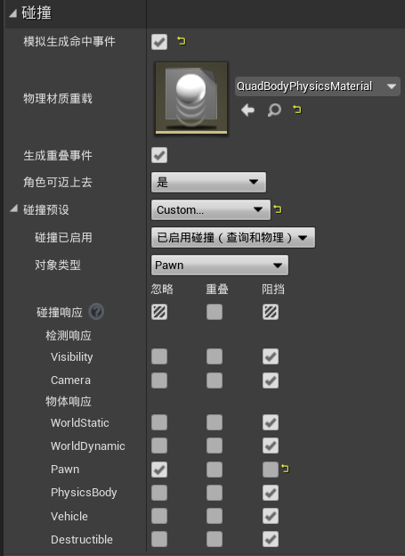

# 多机隔离补丁

[**English**](ISOLATION_PATCH.md) | **简体中文**

[← README](../../README.zh-CN.md) · [配置](README.zh-CN.md) · [仿真器资产](ENVIRONMENT.zh-CN.md)

并行训练将同一场景中的多个机体作为独立样本。原版机间碰撞及 LiDAR 遮挡可能引入该协议不包含的相互作用。本补丁调整无人机 pawn 的碰撞响应，不是多智能体避障策略。

## 参考资产

入库副本为 [project/Content/BP_FlyingPawn.uasset](project/Content/BP_FlyingPawn.uasset)。在完整工程中，应核对实际加载的 AirSim pawn 位于：

    Plugins/AirSim/Content/Blueprints/BP_FlyingPawn.uasset

参考文件为 168,972 字节（165.0 KiB），SHA-256：

    0f4f91c148c81f5ca3ad7079d4d85ade190b65cecf4b1625cc26f8045efd2dd2

哈希一致只能证明文件身份，不能证明运行场景加载了该资产，或全部相关组件都具有预期响应。

## 组件配置

在 BodyMesh 和 Prop0–Prop3 上应用并核查：

| 分类 | 设置 | 参考值 |
|---|---|---|
| Collision | Preset | Custom |
| Collision | Enabled | Query and Physics |
| Collision | Object Type | Pawn |
| Collision | Simulation Generates Hit Events | 开启 |
| Collision | Generate Overlap Events | 开启 |
| Collision | Phys Material Override | QuadBodyPhysicsMaterial |
| Collision | Can Character Step Up On | Yes |
| Trace responses | Visibility | Ignore |
| Trace responses | Camera | Ignore |
| Object responses | Pawn | Ignore |
| Object responses | WorldStatic、WorldDynamic、PhysicsBody、Vehicle、Destructible | Block |

截图为中文编辑器：碰撞预设对应 Collision Presets，碰撞已启用对应 Collision Enabled，对象类型对应 Object Type；忽略／重叠／阻挡分别对应 Ignore／Overlap／Block。

## 两类响应的作用

文档记录的 AirSim LiDAR 路径使用 Visibility 通道做射线检测。网格的 Visibility=Ignore 使射线可以穿过其他无人机网格。这是响应配置修改，不是在 LiDAR 源码中新增 Pawn 类型过滤。

Pawn=Ignore 属于物体响应设置，用于抑制机间碰撞；文档中的世界物体响应保留 Block，使场景障碍保留预期交互。物体类型及其余配置应与参考一致。

## 安装与编辑

可以在完整 AirSim 工程中编辑并保存实际挂载的 pawn，也可以将入库参考资产放入兼容完整工程的上述插件路径。工程自身的额外修改应另外做好版本管理。

不能假定复制到其他 Content 目录即可覆盖插件资产，应在工程中检查被引用的真实路径。换回上游 pawn 后，需要重新应用或验证响应配置。

发布说明记录工程包包含该补丁；仅凭 Git 检出不能确认另行下载归档的内容或运行行为。

## 运行验证

1. 将配置中的机体生成在一起，检查它们不会相互推开。
2. 将第二架机体放在第一架 LiDAR 与背景障碍之间，点云应仍能看到背景表面。
3. 验证与墙、地面及障碍几何的碰撞仍会被报告。

文件大小、时间戳或视觉重叠不足以证明全部三项行为。改变隔离协议可能显著改变观测分布和训练结果；安装补丁本身也不保证收敛。
